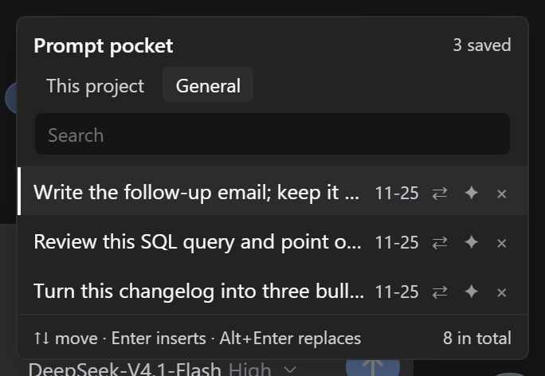

# dsh-prompt-pocket

**A prompt pocket for [DeepSeek Harness](https://github.com/deepseek-ai/deepseek-harness): one keystroke saves what you were typing, one click puts it back at the caret.** It lives as a 24px dot in the corner, so the layout never grows a sidebar, a chip row, or a panel that shifts the conversation. **It also syncs across any number of machines through a private repository you own** — no account, no server of ours, no upload step.



Site: **[dshtoolbox.com/plugins/dsh-prompt-pocket](https://www.dshtoolbox.com/plugins/dsh-prompt-pocket/)** · 中文页: [dshtoolbox.com/zh/plugins/dsh-prompt-pocket](https://www.dshtoolbox.com/zh/plugins/dsh-prompt-pocket/) · npm: [dsh-prompt-pocket](https://www.npmjs.com/package/dsh-prompt-pocket)

## Why it exists

Prompt libraries ask for a title, tags, a folder and a panel before they will keep a sentence. By then you have forgotten the sentence. This one keeps the sentence.

## What it does that others do not

- **`Ctrl+Shift+S` saves without a dialog.** The selection if there is one, the whole draft otherwise. No title, no tags, no “where should this go”.
- **The confirmation appears beside the dot even when the panel is closed** — with a one-click move to the other drawer and a button to rewrite the prompt.
- **Insert is revision-guarded, not string concatenation.** A quote chip or attachment you already had stays where it is, the insert is one undo step, and focus returns to the composer.
- **Two drawers split by workspace, not by session.** Sessions get archived and forked; a prompt pinned to one session loses its home. A bare session falls back to General instead of showing an empty drawer.
- **✦ writes a DSH prompt, it does not paraphrase.** Variables, paths, URLs and code blocks are kept byte-for-byte, nothing is invented, and filler is forbidden by the instruction. A failed or empty result never replaces your text; accepting a rewrite keeps the old one in `prior`.
- **One click on an assistant reply keeps it verbatim** as source material, read from the session log — text blocks only, tool calls never leak in.
- **The agent shares the same pocket** through the `prompt_stash` tool, scoped to the drawers so one project's prompts do not show up in another's answer.
- **Sync through your own private git repository, automatically.** The host pulls on launch, when the panel opens after a stale gap, and every five minutes; each change is pushed three seconds after you make it. The panel pushes each change and merges the remote on launch; prompts are one file each, so a merge keeps both sides instead of corrupting one document. **A public repository is refused** — the plugin asks GitHub whether the repo is visible before it enables sync.
- **Backup and restore as one JSON file.** For machines without git, or for a backup before you trust a sync.
- **500 prompts, least recently used dropped, one JSON file, atomic writes, no runtime dependencies, no account.** Nothing leaves the machine except the one model call you explicitly ask for.


## Any number of machines, synced automatically

**Automatic, not a button.** Change something and it is pushed three seconds later; open the panel and it has already pulled. There is no upload step, no export file, no “send to device”.

This is the case it is built for: a desktop at home, a laptop at work, a Mac in another room, a spare machine you open once a month. **Each one points at the same private repository and keeps a full copy**, so the prompt you saved at noon is on the machine you open at night.


| What you do | What the plugin does |
| --- | --- |
| Save, edit, move or delete a prompt | pushes three seconds later |
| Start DSH | pulls once at launch |
| Open the panel, last sync older than 30 seconds | pulls before you see the list |
| Leave it idle | pulls every five minutes |

Worst case while the panel stays closed is five minutes; opening the panel makes it current. It is not a live socket, on purpose: a socket means a server to keep alive, and this tool has none.

**What travels:** the prompt text, its title, which drawer it belongs to (General or a specific project), how often it was used, the previous version kept by ✦, and deletions.

**What stays local:** the dot’s position, the repository URL and the git credential. Window placement is per browser, not per account.

**A deletion is a tombstone.** `{"id":…,"deletedAt":…}` replaces the prompt so the other machines delete it instead of merging it back; tombstones are pruned after 90 days.

**The same prompt edited on two machines:** the newer `updatedAt` wins, and a deletion beats an edit made before it. No merge dialog — a dialog on every device turns a pocket into a chore.

**A public repository is refused.** Before enabling sync the plugin asks GitHub whether the repository is visible: a 200 stops it, a 404 (private) lets it through.

## Install: one command

```bash
node -e "fetch('https://registry.npmjs.org/dsh-prompt-pocket/latest').then(r=>r.json()).then(j=>console.log(j.version))"
dsh plugin --profile web add dsh-prompt-pocket@<the version printed above>
```

### Let DSH install it

Paste this into DSH; it checks the prerequisites, installs the pinned version, verifies what landed on disk, restarts the host and tells you what to look for. **Needs access to `registry.npmjs.org` and `github.com`; if the network is blocked, it stops and says so instead of changing anything else.**

```
Install the DSH plugin dsh-prompt-pocket, in this order, and stop at the first failure with the exact error:
1. Check node -v is 20 or newer and git --version works.
2. Read the latest version (it prints one version number; note it down):
node -e "fetch('https://registry.npmjs.org/dsh-prompt-pocket/latest').then(r=>r.json()).then(j=>console.log(j.version))"
3. Run: dsh plugin --profile web add dsh-prompt-pocket@<the version from step 2> (pin it: pnpm's minimumReleaseAge can resolve an older one).
4. Read ~/.dsh/profiles/web/node_modules/dsh-prompt-pocket/package.json and confirm the version matches step 2.
5. Restart the host: on Windows stop DSH021-Web and start it again; on macOS run launchctl kickstart -k gui/$(id -u)/com.deepseek.dsh.web
6. Open http://127.0.0.1:2081 and force-reload (Ctrl+Shift+R on Windows, Cmd+Shift+R on macOS); a faint dot should appear in the bottom-right corner.
Do not use npm view for this: npm can refuse with EBADDEVENGINES. Needs registry.npmjs.org and github.com. If either is unreachable, stop and report the error instead of changing other configuration.
```

Or install from the repository:

```bash
git clone https://github.com/FindSomeSkills/dsh-prompt-pocket
cd dsh-prompt-pocket
dsh plugin --profile web add .
```

## Use

| Action | How |
| --- | --- |
| Save the selection or the draft | `Ctrl+Shift+S` |
| Open or close the pocket | `Ctrl+Shift+P`, or click the dot |
| Move the dot | Drag it; the position is remembered per browser |
| Insert a prompt at the caret | `Enter`, or click the row |
| Replace the whole draft | `Alt+Enter` while a row is selected |
| Walk the list | `↑` `↓` (wraps around), `Esc` closes |
| Move a prompt between drawers | `⇄` on the row |
| Delete | `×` on the row |
| Rewrite the prompt for DSH | `✦`, or the button on the save confirmation |
| Save an assistant reply | `⤓` in the reply action row |

## Where the data lives

`$DSH_HOME/dsh-prompt-stash/store.d/`, one JSON file per prompt, plus tombstones for deletions. Every profile and every browser pointed at this host reads the same directory. Writes go through a temporary file and a rename; a damaged entry is renamed to `.corrupt-<timestamp>.bak` and skipped instead of blocking the panel.

## Upgrading: one command

**There is no auto-update.** The install writes an exact version into the profile and DSH has no updater daemon: nothing changes until you run a command. That is deliberate — the plugin runs inside the host process, and swapping its files under a live process leaves half the routes on the old code.

**A pinned version is why an upgrade needs the number.** `dsh plugin add` without `@x.y.z` can resolve to a cached older release because of pnpm’s `minimumReleaseAge` policy.

Read the latest version, install it pinned, then restart the host (Windows: stop DSH021-Web and start it again; macOS: `launchctl kickstart -k gui/$(id -u)/com.deepseek.dsh.web`).

```bash
node -e "fetch('https://registry.npmjs.org/dsh-prompt-pocket/latest').then(r=>r.json()).then(j=>console.log(j.version))"
dsh plugin --profile web add dsh-prompt-pocket@<the version printed above>
```

### Upgrading: let DSH do it

Paste this into DSH:

```
Upgrade the DSH plugin dsh-prompt-pocket:
1. Read the current version: cat ~/.dsh/profiles/web/node_modules/dsh-prompt-pocket/package.json | grep '"version"'
2. Read the latest version (it prints the number):
node -e "fetch('https://registry.npmjs.org/dsh-prompt-pocket/latest').then(r=>r.json()).then(j=>console.log(j.version))"
3. If they are equal, say "already current" and change nothing.
4. Otherwise run dsh plugin --profile web add dsh-prompt-pocket@<latest> (pin the version).
5. Read the version on disk again and confirm it changed.
6. Restart the host: on Windows stop DSH021-Web and start it again; on macOS run launchctl kickstart -k gui/$(id -u)/com.deepseek.dsh.web
7. Open http://127.0.0.1:2081, force-reload, and confirm the panel footer shows the sync state.
Needs registry.npmjs.org. If anything fails, stop and show me the exact error.
```

## Requirements

DeepSeek Harness `>= 0.2.0-rc.1` and a Web profile — the pocket renders inside the composer. Windows, macOS and Linux run the same code; the interface language follows the DSH setting. The desktop client is untested.

## Links

- Product page: https://www.dshtoolbox.com/plugins/dsh-prompt-pocket/
- Chinese page: https://www.dshtoolbox.com/zh/plugins/dsh-prompt-pocket/
- npm: https://www.npmjs.com/package/dsh-prompt-pocket
- Manual: [docs/DETAIL.md](docs/DETAIL.md) (English) · [docs/DETAIL.zh.md](docs/DETAIL.zh.md) (中文)

MIT.
