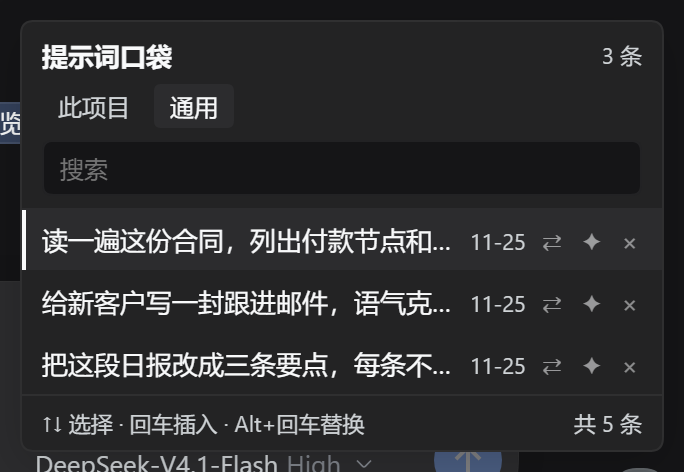

# dsh-prompt-pocket

**给 [DeepSeek Harness](https://github.com/deepseek-ai/deepseek-harness) 用的提示词口袋：一个快捷键存下你正在打的字，一次点击把它插回光标处。** 它就是角落里一枚 24px 的圆点，界面不会因此长出一条侧栏、一排胶囊，或者一个挤压对话的面板。**它还通过你自己的私有仓库在多台机器之间自动同步**——不要账号、没有我们的服务器、没有上传这一步。



站点：**[dshtoolbox.com/zh/plugins/dsh-prompt-pocket](https://www.dshtoolbox.com/zh/plugins/dsh-prompt-pocket/)** · English: [dshtoolbox.com/plugins/dsh-prompt-pocket](https://www.dshtoolbox.com/plugins/dsh-prompt-pocket/) · npm: [dsh-prompt-pocket](https://www.npmjs.com/package/dsh-prompt-pocket)

## 为什么做这个

提示词库要先让你起标题、打标签、建文件夹、开面板，然后才肯收下一句话。等你填完，那句话已经忘了。这个不填，直接收。

## 别处没有的几件事

- **`Ctrl+Shift+S` 存，不弹窗。** 有选中存选中，没选中存整段草稿。不起标题、不选标签、不问放哪。
- **面板关着也能看见存到哪了。** 圆点旁边出一条两秒的提示，带「改存另一档」和「写成 DSH 提示词」两个按钮。
- **插入走输入框的修订号保护，不是拼字符串。** 你已经插的引用 chip、挂的附件都留在原地，插入是一步撤销，插完焦点回到输入框。
- **两个抽屉按 workspace 分，不按会话分。** 会话会归档、会 fork，绑在会话上的提示词那天就没了家；没有 workspace 的裸会话退成通用，而不是给你一个空标签页。
- **✦ 写的是 DSH 提示词，不是同义改写。** `{{变量}}`、路径、URL、代码块原样保留，没说过的东西不编，套话在被禁之列。失败或空结果绝不覆盖原文；接受新版本时旧文本留在 `prior` 里，一键退回。
- **AI 回复一键存原文。** 从会话日志里只取 text 块，工具调用不会漏进提示词。
- **模型共用同一个口袋。** `prompt_stash` 工具读写同一份文件，且守分档，一个项目的提示词不会出现在另一个项目的回答里。
- **用你自己的私有 git 仓库自动同步。** 启动时拉一次，面板打开时如果上次同步超过 30 秒也会拉，另外每五分钟拉一次；改动后三秒推送。 每次改动自动提交推送，启动时合并远端；一条提示词一个文件，所以合并会让两边都留下，而不是把一份文档写坏。**公开仓库会被直接拒绝**——开启前插件会问一次 GitHub，这个仓库是不是公开的。
- **备份与恢复就是一个 JSON 文件。** 给没有 git 的机器用，或者在信任同步之前先做一次备份。
- **最多 500 条，满了淘汰最久没用的那条；一个 JSON 文件、原子写、没有运行时依赖、不需要账号。** 除了你主动点的那一次模型调用，什么都不出这台机器。


## 多少台机器都行，自动同步

**是自动的，不是按钮。** 改了，三秒后推送；打开面板时已经拉过了。没有上传这一步，不用导出文件，也没有「发送到设备」。

这就是它要解决的场景：家里一台台式机、公司一台笔记本、书房一台 Mac，可能还有一台一个月才开一次的备用机。**每台填同一个私有仓库地址，各自存一份完整副本**，中午在台式机上存的提示词，晚上打开另一台就在。


| 你做了什么 | 插件做了什么 |
| --- | --- |
| 存、改、挪档、删除 | 三秒后推送 |
| 启动 DSH | 启动时拉一次 |
| 打开面板，距上次同步超过 30 秒 | 先拉再给你看清单 |
| 一直不动它 | 每五分钟拉一次 |

面板关着时最坏五分钟，打开面板就是最新的。没有用长连接，是有意的：长连接意味着要有一台服务器一直活着，而这个工具没有服务器。

**同步的内容：** 提示词正文、标题、属于哪一档（通用 / 某个项目）、使用次数、✦ 留下的上一版、以及删除。

**不同步的：** 圆点位置、仓库地址、git 凭据。窗口位置是每个浏览器各自的。

**删除是墓碑。** `{"id":…,"deletedAt":…}` 覆盖那条提示词，其他机器据此删除，而不是合并回来；墓碑保留 90 天后清理。

**同一条在两台机器上都被改过：** `updatedAt` 新的赢；删除比它之前的修改优先。没有合并对话框——每台设备弹一次，口袋就变成负担。

**公开仓库直接拒绝。** 备份与恢复留给没有 git 的机器，也是同步出问题时的一条退路。 开启前问一次 GitHub：200 说明公开，停下；404 说明私有，放行。

## 安装：一条命令

```bash
node -e "fetch('https://registry.npmjs.org/dsh-prompt-pocket/latest').then(r=>r.json()).then(j=>console.log(j.version))"
dsh plugin --profile web add dsh-prompt-pocket@<上面打印的版本>
```

### 让 DSH 装：把这段发给它

把下面这段发给 DSH：它会检查前置条件、装写死的版本、核对磁盘上的版本、重启宿主，再告诉你该看到什么。**需要能访问 `registry.npmjs.org` 和 `github.com`；网络不通它会停下并说明，不会去改别的配置。**

```
帮我安装 DSH 插件 dsh-prompt-pocket，按顺序做，哪一步失败就停下把原文报给我：
1. 检查 node -v 是否 20 或更高，git --version 是否可用；
2. 查最新版本（会打印一个版本号，记下来）：
node -e "fetch('https://registry.npmjs.org/dsh-prompt-pocket/latest').then(r=>r.json()).then(j=>console.log(j.version))"
3. 执行 dsh plugin --profile web add dsh-prompt-pocket@<第 2 步打印的版本>（版本必须写死，pnpm 会跳过刚发布的版本）；
4. 读 ~/.dsh/profiles/web/node_modules/dsh-prompt-pocket/package.json，确认 version 与第 2 步一致；
5. 重启宿主：Windows 停掉 DSH021-Web 再启动；macOS 执行 launchctl kickstart -k gui/$(id -u)/com.deepseek.dsh.web；
6. 打开 http://127.0.0.1:2081，强刷页面（Windows Ctrl+Shift+R / macOS Cmd+Shift+R），确认右下角出现一枚圆点。
不要用 npm view 查版本（npm 可能因为 devEngines 报 EBADDEVENGINES）。需要能访问 registry.npmjs.org 和 github.com；网络不通就告诉我，不要改别的配置。
```

从源码装：

```bash
git clone https://github.com/FindSomeSkills/dsh-prompt-pocket
cd dsh-prompt-pocket
dsh plugin --profile web add .
```

## 用法

| 要做什么 | 怎么做 |
| --- | --- |
| 存选中内容或整段草稿 | `Ctrl+Shift+S` |
| 开 / 关面板 | `Ctrl+Shift+P`，或点圆点 |
| 挪圆点 | 按住拖；位置按浏览器记住 |
| 插到光标处 | `Enter`，或直接点那一行 |
| 整段替换 | 选中行后 `Alt+Enter` |
| 上下选 | `↑` `↓`（循环），`Esc` 关 |
| 在两个档之间挪 | 行尾 `⇄` |
| 删除 | 行尾 `×` |
| 写成 DSH 提示词 | 行尾 `✦`，或存完提示里的按钮 |
| 存一条 AI 回复 | 回复动作行的 `⤓` |

## 数据在哪

`$DSH_HOME/dsh-prompt-stash/store.d/`，一条提示词一个 JSON 文件，删除留墓碑。所有 profile、所有连到这台机器的浏览器读同一个目录。写入走临时文件 + rename；某一条坏了会改名成 `.corrupt-<时间戳>.bak` 并跳过，不会挡住面板。

## 升级：一条命令

**没有自动升级。** 安装时把精确版本写进了 profile，DSH 也没有更新守护进程：你不敲命令，版本就不会变。这是有意的——插件跑在宿主进程里，运行中换文件会让一半路由停在旧代码上。

**写死版本也是升级要带版本号的原因。** 不带 `@x.y.z` 执行 `dsh plugin add`，pnpm 的 `minimumReleaseAge` 策略可能解析成缓存里的旧版本。

先读最新版本，写死安装，再重启宿主（Windows 停掉 DSH021-Web 再启动；macOS 执行 `launchctl kickstart -k gui/$(id -u)/com.deepseek.dsh.web`）。

```bash
node -e "fetch('https://registry.npmjs.org/dsh-prompt-pocket/latest').then(r=>r.json()).then(j=>console.log(j.version))"
dsh plugin --profile web add dsh-prompt-pocket@<上面打印的版本>
```

### 升级：让 DSH 做

把这段发给 DSH：

```
帮我升级 DSH 插件 dsh-prompt-pocket：
1. 读当前版本：cat ~/.dsh/profiles/web/node_modules/dsh-prompt-pocket/package.json | grep '"version"'
2. 查最新版本（会打印版本号）：
node -e "fetch('https://registry.npmjs.org/dsh-prompt-pocket/latest').then(r=>r.json()).then(j=>console.log(j.version))"
3. 两者相同就告诉我「已是最新」，不要动任何文件；
4. 不同则执行 dsh plugin --profile web add dsh-prompt-pocket@<最新版本>（版本写死）；
5. 再读一次磁盘版本，确认已变；
6. 重启宿主：Windows 停掉 DSH021-Web 再启动；macOS 执行 launchctl kickstart -k gui/$(id -u)/com.deepseek.dsh.web
7. 打开 http://127.0.0.1:2081 强刷页面，确认面板底部能同步。
不要用 npm view 查版本（npm 可能因为 devEngines 报 EBADDEVENGINES）。需要能访问 registry.npmjs.org；失败就停下把原文给我。
```

## 运行要求

DeepSeek Harness `>= 0.2.0-rc.1`，Web profile——口袋渲染在输入框里。Windows、macOS、Linux 跑同一份代码；界面语言跟随 DSH 的设置。桌面客户端没验证过。

## 链接

- 产品页：https://www.dshtoolbox.com/zh/plugins/dsh-prompt-pocket/
- 英文页：https://www.dshtoolbox.com/plugins/dsh-prompt-pocket/
- npm：https://www.npmjs.com/package/dsh-prompt-pocket
- 使用手册：[docs/DETAIL.zh.md](docs/DETAIL.zh.md) · [docs/DETAIL.md](docs/DETAIL.md)

MIT。
